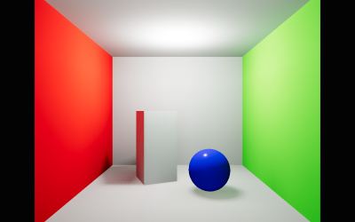

<!--
SPDX-FileCopyrightText: 2021 Takahiro Aoyagi
SPDX-FileCopyrightText: 2026 Ben Houston
SPDX-License-Identifier: CC-BY-4.0
-->

# EXT_lightmap

## Contributors

- Ben Houston, [@bhouston](https://github.com/bhouston)
- Takahiro Aoyagi, [@takahirox](https://github.com/takahirox), author of the original [`MOZ_lightmap`](https://github.com/takahirox/MOZ_lightmap) draft

## Status

Draft

## Dependencies

Written against the glTF 2.0 spec.

This extension may be used together with `KHR_texture_transform`, `KHR_materials_unlit`, and `KHR_lights_punctual`.

This extension standardizes the widely deployed `MOZ_lightmap` extension. See [Compatibility with Existing Content](#compatibility-with-existing-content).

## Overview

A light map is a texture containing precomputed (baked) diffuse lighting for a surface. Light maps let real-time renderers display global illumination effects such as indirect bounce lighting, color bleeding, and soft shadowing at the cost of a single texture lookup. They are widely used in games, architectural visualization, and web and XR scenes where the scene's static geometry and lighting are known ahead of time.

This extension adds a light map to a glTF material. The light map stores linear RGB diffuse irradiance, usually in a dedicated, non-overlapping texture coordinate set. The renderer adds this irradiance to the material's diffuse lighting. Light maps do not affect specular reflections.

The baked irradiance may contain either:

- **indirect diffuse lighting only**, for scenes where direct lighting from some or all lights is still computed at runtime, or
- **total diffuse lighting** (direct and indirect), for fully baked scenes.

Both are diffuse irradiance and are rendered the same way. The content creator chooses which one to bake and which lights to keep in the scene (see [Baked and Dynamic Lights](#baked-and-dynamic-lights)).

<figure>

<figcaption><em>A Cornell box with baked indirect diffuse lighting stored in a light map, combined with a dynamic <code>KHR_lights_punctual</code> point light.</em></figcaption>
</figure>

## Extending Materials

A light map is added to a material by adding the `EXT_lightmap` extension to the material's `extensions` property.

```json
"materials": [
    {
        "pbrMetallicRoughness": {
            "baseColorFactor": [ 1.0, 0.0, 0.0, 1.0 ],
            "baseColorTexture": {
                "index": 0
            }
        },
        "extensions": {
            "EXT_lightmap": {
                "index": 1,
                "texCoord": 1,
                "intensity": 1.0
            }
        }
    }
]
```

The extension object is a core glTF [`textureInfo`](https://registry.khronos.org/glTF/specs/2.0/glTF-2.0.html#reference-textureinfo) with an additional `intensity` property.

| Property      | Type      | Description                                                                                      | Required             |
| :------------ | :-------- | :----------------------------------------------------------------------------------------------- | :------------------- |
| **index**     | `integer` | The index of the texture that contains the light map.                                            | ✅ Yes               |
| **texCoord**  | `integer` | The set index of the texture's `TEXCOORD` attribute used for texture coordinate mapping.         | No, default: `0`     |
| **intensity** | `number`  | A linear multiplier applied to the light map's RGB values. Must be greater than or equal to `0`. | No, default: `1.0`   |

### Texture Coordinates

Light maps usually need a unique, non-overlapping UV layout, which is generally different from the layout used for the material's other textures, so most assets put light map coordinates in `TEXCOORD_1`. As with any `textureInfo`, `texCoord` selects the set and defaults to `0`.

The light map `textureInfo` may use `KHR_texture_transform`. One use is placing several materials into one shared light map atlas.

## Light Map Content

The light map texture contains **linear** (not sRGB-encoded) RGB values. The alpha channel, if present, **MUST** be ignored. Implementations **MUST NOT** apply the sRGB transfer function when sampling the light map, even if the same image is also used by a color texture slot.

The diffuse irradiance `E` incident on the surface is:

```
E = intensity * lightmap.rgb
```

`E` uses the same photometric convention as `KHR_lights_punctual`, where a directional light's intensity is the illuminance on a surface facing the light. In renderers that use physical light units, `E` is in lux (lm/m²), and a light gives the same result whether it is baked into the light map or kept dynamic. Some baking tools produce values already divided by π (so that "outgoing color = albedo × value"). Exporters **MUST** convert such values to irradiance by multiplying them, or `intensity`, by π.

### Shading

Light map irradiance is diffuse irradiance arriving from the hemisphere above the surface. Implementations **MUST** pass it through the material's diffuse BRDF, as they do for diffuse irradiance from image-based lighting. They **SHOULD** apply the same weights that apply to the diffuse lobe (for example metallic, Fresnel, and layering terms from extensions such as `KHR_materials_clearcoat` or `KHR_materials_sheen`). For the core metallic-roughness material, ignoring those weights, the light map adds:

```
f_lightmap = (c_diff / π) * E
c_diff = lerp(baseColor.rgb, black, metallic)
```

Light maps contain no directional information and do not contribute to specular reflection. Emission is unaffected.

The core `occlusionTexture` applies to indirect lighting. For this purpose, light map irradiance counts as indirect lighting, so occlusion **MUST** be applied to it. Bakes usually already contain occlusion, so content creators **SHOULD** make sure the occlusion texture does not darken the same regions twice. Either omit it or limit it to detail finer than the light map resolution.

### Unlit Materials

When a material also uses `KHR_materials_unlit`, the light map shades it as a Lambertian surface lit only by the light map:

```
color = baseColor.rgb * E / π
```

So the same light map gives a lit material and an unlit material of the same color the same diffuse result. This allows fully baked scenes to be rendered with unlit materials at minimal cost. Without this extension, an unlit material displays `baseColor` unchanged.

### Baked and Dynamic Lights

The renderer always adds light map irradiance on top of whatever lighting it computes at runtime. To avoid counting the same light twice, the content creator decides which lighting is baked and which is dynamic:

- If the light map contains **indirect diffuse lighting only**, the scene's lights (for example, defined with `KHR_lights_punctual`) remain in the asset and supply direct lighting and all specular lighting at runtime.
- If the light map contains **total diffuse lighting**, lights whose direct contribution was baked **SHOULD NOT** also illuminate the light-mapped surfaces at runtime. They can be removed from the asset or kept only for specular highlights or unbaked objects, depending on what the target renderer supports.

Light maps usually include light from the environment (sky) as well. Applications **SHOULD NOT** also add diffuse lighting from the same environment to light-mapped materials, whether it comes from image-based lighting or from ambient or hemisphere lights. Specular image-based lighting is unaffected.

## Implementation Notes

_This section is non-normative._

- **Unwrapping and padding.** Light map UV charts should not overlap, and should be padded and dilated so that bilinear filtering and mipmapping don't bleed between charts.
- **Dynamic range.** Irradiance often exceeds `1.0`. With 8-bit formats such as PNG and JPEG, store normalized values and put the scale factor in `intensity`. Store dark scenes with care to avoid banding. Where available, texture extensions providing higher dynamic range or higher precision formats may be used for the referenced texture.
- **Static content.** Light maps only describe the lighting of the geometry and lights at bake time. They are suited to static geometry. A light map on a moving or deforming mesh stays attached to the surface and will look incorrect.
- **Instancing.** The light map belongs to the material and is addressed through mesh texture coordinates. A mesh referenced by several nodes therefore shares one light map region. To give instances unique lighting, use distinct meshes or primitives with their own `TEXCOORD` data, or distinct materials with different `KHR_texture_transform` offsets.
- **Environment lighting.** Some renderers add diffuse environment lighting to every material by default (three.js, for example, adds `scene.environment` irradiance even when a light map is present). Implementations should suppress it for light-mapped materials, or document that applications must not combine the two.

## Fallback

This extension is optional. Assets using it **SHOULD NOT** add `EXT_lightmap` to `extensionsRequired`. Clients that don't support it render the material without baked lighting, using only the lights and environment available at runtime. Assets that bake total lighting and remove the baked lights will look darker in such clients. Content creators targeting both kinds of client may want to keep an approximate runtime lighting setup.

## Compatibility with Existing Content

`EXT_lightmap` standardizes `MOZ_lightmap`, which was drafted at Mozilla for Hubs and is used by Hubs, Spoke, the Hubs Blender add-on, and several other engines (see [Known Implementations](#known-implementations)). The JSON structure is the same: a `textureInfo` plus `intensity`. Deployed `MOZ_lightmap` content and tools behave as follows:

| Behavior | `MOZ_lightmap` (as deployed) | `EXT_lightmap` |
| :------- | :--------------------------- | :------------- |
| Texture coordinates | Several readers ignore `texCoord` and `KHR_texture_transform` and always use `TEXCOORD_1`. Some writers omit `texCoord`. | `texCoord` and `KHR_texture_transform` follow core `textureInfo`. |
| Lit materials | `(c_diff / π) * E` | Same |
| Unlit materials | `baseColor.rgb * E` (Hubs, iR Engine) | `baseColor.rgb * E / π` |
| Color space | Linear. Spoke decoded light maps as sRGB. | Linear |
| HDR | The Hubs Blender add-on writes RGBE `.hdr` images using `MOZ_texture_rgbe`. | Any texture extension that provides higher dynamic range |
| `intensity` | The Hubs Blender importer fails when it is missing. | Optional, default `1.0` |

Readers **MAY** also accept `MOZ_lightmap`. When they do, they **SHOULD** apply the `MOZ_lightmap` column above: use `TEXCOORD_1` when `texCoord` is absent, and use `baseColor.rgb * E` for unlit materials. If a material contains both extensions, readers **MUST** use `EXT_lightmap` and ignore `MOZ_lightmap`. Writers **SHOULD** write `EXT_lightmap`. Writers targeting older clients **MAY** also write `MOZ_lightmap` on the same material, with `texCoord` and `intensity` written explicitly.

## glTF Schema Updates

- **JSON schema**: [material.EXT_lightmap.schema.json](schema/material.EXT_lightmap.schema.json)

## Known Implementations

`EXT_lightmap`:

- [three.js](https://github.com/mrdoob/three.js/pull/34950): loader and exporter plugins (pull request, in progress).

`MOZ_lightmap` (predecessor):

- [Mozilla Hubs](https://github.com/Hubs-Foundation/hubs/blob/master/src/components/gltf-model-plus.js): loader. Always uses `TEXCOORD_1`.
- [Hubs Blender add-on](https://github.com/Hubs-Foundation/hubs-blender-exporter): Blender import and export.
- [Spoke](https://github.com/Hubs-Foundation/Spoke/tree/master/src/editor/gltf/extensions): Hubs scene editor, import and export.
- [hubs-glb-tools](https://github.com/Hubs-Foundation/hubs-glb-tools/blob/master/src/MozLightmap.ts): glTF-Transform extension.
- [iR Engine (formerly Ethereal Engine)](https://github.com/ir-engine/ir-engine): loader and glTF-Transform extension. Always uses `TEXCOORD_1`.
- [EE Bridge Unity Exporter](https://github.com/EtherealEngine/EE-Bridge-Unity-Export): Unity export.
- [Third Room](https://github.com/matrix-org/thirdroom), [Webaverse](https://github.com/webaverse/app), and [aframe-gltf-model-plus](https://github.com/c-frame/aframe-gltf-model-plus): loaders.

## Sample Assets

- [LightmappedCornellBox.glb](https://github.com/bhouston/three.js/tree/gltf-light-map/examples/models/gltf/LightmappedCornellBox): Cornell box with baked indirect diffuse lighting in a shared light map atlas and a dynamic `KHR_lights_punctual` point light.

## Resources

- [Original `MOZ_lightmap` draft](https://github.com/takahirox/MOZ_lightmap)
- [`MX_lightmap`](https://thirdroom.io/docs/gltf/mx_lightmap/readme), a related extension that adds per-node atlas transforms and RGBM encoding.

## Intellectual Property (IP) Status

This specification is licensed under CC-BY-4.0. The contributors are not aware of any patents or other intellectual property claims covering it. Anyone may implement it royalty-free.

## Trademarks

Mozilla is a trademark of the Mozilla Foundation. Hubs is a trademark of its respective owner. Blender is a trademark of the Blender Foundation. Unity is a trademark of Unity Technologies. All other trademarks are the property of their respective owners.
